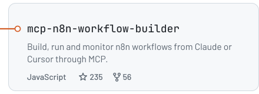
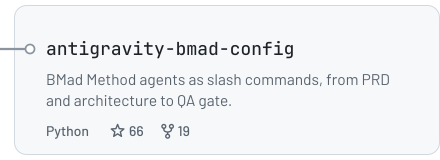
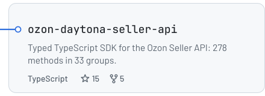
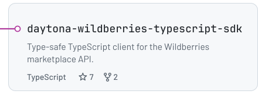
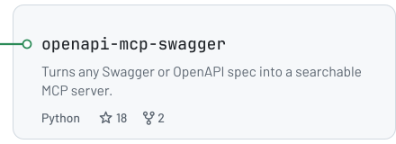
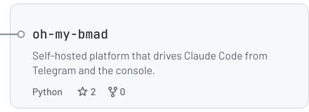

<picture>
  <source media="(prefers-color-scheme: dark)" srcset="./assets/hero-dark.svg">
  
</picture>

I build AI-first products: systems where agents, workflows and APIs are part of the architecture from the first commit, not a chatbot added later. Most of my open-source work is the harness that lets agents operate real systems safely.

### Selected work

<!-- CARDS:START -->

<a href="https://github.com/salacoste/mcp-n8n-workflow-builder"><picture><source media="(prefers-color-scheme: dark)" srcset="./assets/cards/mcp-n8n-workflow-builder-dark.svg"></picture></a> <a href="https://github.com/salacoste/antigravity-bmad-config"><picture><source media="(prefers-color-scheme: dark)" srcset="./assets/cards/antigravity-bmad-config-dark.svg"></picture></a>
<a href="https://github.com/salacoste/ozon-daytona-seller-api"><picture><source media="(prefers-color-scheme: dark)" srcset="./assets/cards/ozon-daytona-seller-api-dark.svg"></picture></a> <a href="https://github.com/salacoste/daytona-wildberries-typescript-sdk"><picture><source media="(prefers-color-scheme: dark)" srcset="./assets/cards/daytona-wildberries-typescript-sdk-dark.svg"></picture></a>
<a href="https://github.com/salacoste/openapi-mcp-swagger"><picture><source media="(prefers-color-scheme: dark)" srcset="./assets/cards/openapi-mcp-swagger-dark.svg"></picture></a> <a href="https://github.com/salacoste/oh-my-bmad"><picture><source media="(prefers-color-scheme: dark)" srcset="./assets/cards/oh-my-bmad-dark.svg"></picture></a>

<!-- CARDS:END -->

### How I build

- APIs instead of screenshots
- Workflows instead of one-off prompts
- Typed SDKs instead of fragile scripts
- Repeatable processes instead of chaotic agent sessions

Mostly TypeScript and Python, with Rust and Go where they pay off.

<!-- STATS:START -->
349 stars and 85 forks across 29 original repositories. Cards and numbers refresh daily.
<!-- STATS:END -->
